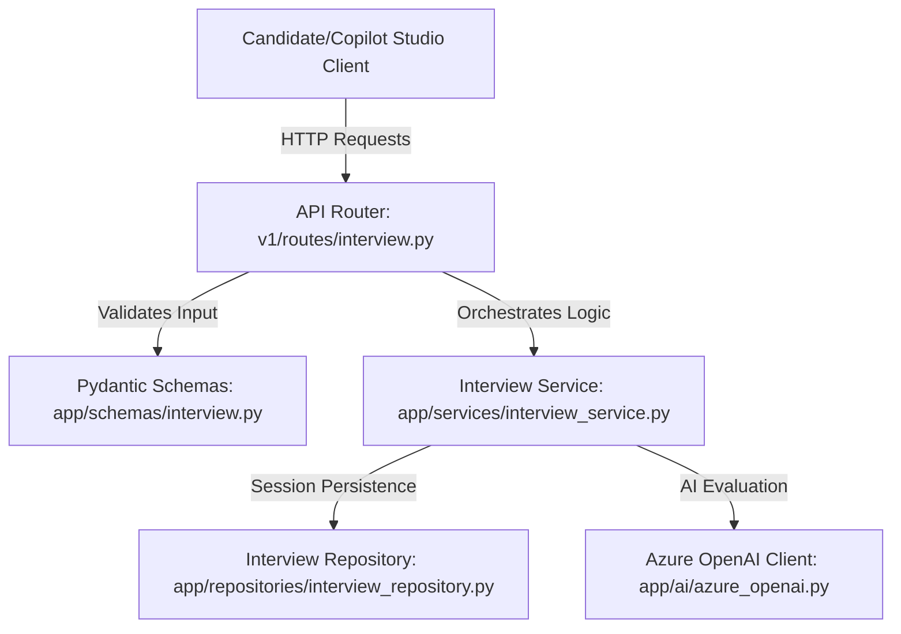

# FastAPI Copilot Implementation Guide

This document provides a comprehensive overview of the **FastAPI backend implementation** designed to power the AI Copilot and custom integrations (such as **Microsoft Copilot Studio**) for the JOBRO interview intelligence platform.

---

## 🏗️ Architectural Overview

The backend acts as a modular API gateway and orchestration layer, separating routing, schemas, business logic, and repository services.

---

## 🛠️ Key Components & Endpoints

### 1. Interactive Chat & Dialogue (`/api/v1/interview/chat`)
This endpoint manages the core interactive interview dialogue between the candidate and the AI Copilot.
* **OpenAI Integration:** Communicates with Azure OpenAI using candidate-specific `cv_text` and `job_description` to ask relevant technical/situational questions.
* **On-the-Fly Coaching Insights:** Real-time coaching is computed on the fly based on the candidate's last reply:
  - If response length is **< 30 characters**, it suggests: *"Try structuring your answer with the STAR method (Situation, Task, Action, Result)..."*
  - If response contains **impact keywords** (e.g., `star`, `led`, `solved`, `result`, `impact`, `metric`), it encourages: *"Excellent detail on your specific impact. Keep using metrics and outcomes!"*
  - Otherwise, it guides: *"Good answer. Consider explaining the exact steps you took and the final outcome."*

### 2. Copilot Studio Stateless Chat (`/api/v1/interview/chat_simple`)
Designed specifically for integrations like **Microsoft Copilot Studio**:
* **Session Persistence:** Rather than requiring the client or Copilot Studio to maintain the full conversational history, `/chat_simple` automatically reads/updates session context internally.
* **Process Flow:**
  1. Retrieves existing context and chat history by `interview_id`.
  2. Appends the new user message.
  3. Generates the response via Azure OpenAI.
  4. Appends the assistant response.
  5. Saves updated context back to the store.
  6. Computes dynamic coaching insights.

### 3. Context Management (`/api/v1/interview/context`)
Provides endpoints to save (`POST`) and retrieve (`GET`) candidate background context (CV text and Job Description) for a specific session.
* **External Access:** Allows the frontend or external Custom Connectors to register background context before initiating the dialogue.

### 4. Comprehensive Evaluation & Feedback (`/api/v1/interview/feedback`)
Generates structured detailed report cards once the candidate finishes the interview:
* Calculates tailored mock scores (**Overall**, **Communication**, **Technical**) based on performance and answer substance (e.g., penalizing very short replies, rewarding rich detailed technical answers).

---

## 📂 Codebase Reference & Files

* **Router:** [interview.py](file:///c:/Users/Rahul/Documents/GitHub/Jobro%202.0/apps/backend/app/api/v1/routes/interview.py) — Defines routes for `/chat`, `/chat_simple`, `/context`, `/feedback`, and `/submit`.
* **Schemas:** [interview.py](file:///c:/Users/Rahul/Documents/GitHub/Jobro%202.0/apps/backend/app/schemas/interview.py) — Strictly-typed Pydantic models for request validation and response formatting.
* **Service:** [interview_service.py](file:///c:/Users/Rahul/Documents/GitHub/Jobro%202.0/apps/backend/app/services/interview_service.py) — Coordinates evaluation pipelines and session context state.
* **Repository:** [interview_repository.py](file:///c:/Users/Rahul/Documents/GitHub/Jobro%202.0/apps/backend/app/repositories/interview_repository.py) — Uses optimized in-memory global state stores (`_IN_MEMORY_CONTEXT_STORE`, `_IN_MEMORY_INTERVIEW_STORE`) to persist interview progression reliably across request lifecycles.
